# stochastic-lob

**Stochastic models of the limit order book, order flow, price impact, and the liquidity provider's problem.** Ten slide decks and the open code behind every number in them.

📊 **Overview deck:** [`slides/stochastic-lob-slides.pdf`](slides/stochastic-lob-slides.pdf) (65 slides) &nbsp;·&nbsp; 🔬 **Nine deep dives:** [`slides/decks/`](slides/decks/) &nbsp;·&nbsp; 📖 **Docs:** [`docs/`](docs/README.md) &nbsp;·&nbsp; 📓 **Notebook:** [`notebooks/tour.ipynb`](notebooks/tour.ipynb)

The overview deck covers the main stochastic models of the book, what order flow does to prices, the problems liquidity providers (LPs) work on now, research from 2023 to 2026, and open problems. Each deep dive takes one topic further: the model and its math, how to estimate it and with what uncertainty, figures from this code, what published research reports, and a discussion for LPs.

There is no market data in this repository. Every figure is a simulation, every closed form is checked against an independent computation, and every estimate carries a standard error. Published facts are quoted from the cited papers. The estimators also run on real order book data in the LOBSTER format ([docs/data.md](docs/data.md)).

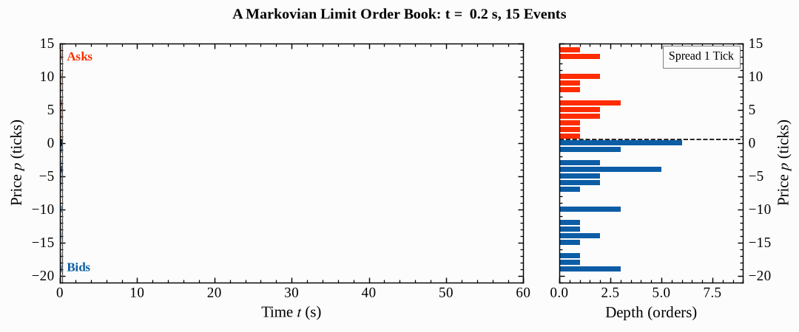

*One simulated minute of a Markovian (Cont-Stoikov-Talreja) order book. Left: the depth at every price fills in as time runs (asks red, bids blue, darker is deeper; best quotes in black). Right: the depth profile right now, which changes with every limit order, cancellation and market order.*

## The deep dives

| # | Deck | Math | Statistics | New in this repository |
|---|---|---|---|---|
| 1 | [Markovian order book](slides/decks/01-markovian-order-book.pdf) | zero intelligence, Cont-Stoikov-Talreja, M/M/∞ depth | Poisson MLE with exposure | rate recovery from LOBSTER files; depth truncation biases cancellation rates |
| 2 | [Best queues](slides/decks/02-best-queues.pdf) | first passage, $p_\uparrow$, $1/t$ durations, diffusion limit | conditional frequencies, clustered errors | constant-rate formula vs a state-dependent book; binomial errors overstate significance |
| 3 | [Queue-reactive models](slides/decks/03-queue-reactive-models.pdf) | birth-death stationary law, Model III | nonparametric intensity MLE | reduced Model III: the book alone mean-reverts; news restores volatility |
| 4 | [Hawkes order flow](slides/decks/04-hawkes-order-flow.pdf) | branching, stationarity, signature plot, rough limits | likelihood, time-rescaling test | an exponential fit sees under half of a slow kernel; seasonality fakes $n \approx 0.92$ |
| 5 | [Price impact](slides/decks/05-price-impact.pdf) | propagator, critical decay, latent order book | Toeplitz estimator, block bootstrap | exact linear-to-square-root crossover; truncation bias; response is not impact |
| 6 | [OFI and micro-price](slides/decks/06-order-flow-imbalance-microprice.pdf) | OFI, multi-level and integrated OFI, micro-price | out-of-sample $R^2$, overlapping horizons | micro-price estimated and tested out of sample |
| 7 | [Optimal market making](slides/decks/07-optimal-market-making.pdf) | HJB, Avellaneda-Stoikov, exact GLFT | fill-curve MLE with censoring | cost of a wrong fill curve; signal shrinkage |
| 8 | [Adverse selection and priority](slides/decks/08-adverse-selection-queue-priority.pdf) | P&L identity, Glosten-Milgrom, Kyle | markouts | queue value with informed sweeps; toxicity from queue mechanics alone |
| 9 | [AMM liquidity](slides/decks/09-amm-liquidity.pdf) | loss-versus-rebalancing | Monte Carlo | LVR of concentrated liquidity $\sigma^2/(8(1-w^{-1/2}))$ |

Each deck has a matching page in [`docs/topics/`](docs/topics/).

## See the simulations

Most numbers in this repository are statistics of simulated random objects. These figures show the objects themselves. The animations come from [`experiments/animations.py`](experiments/animations.py) and the gallery from [`experiments/gallery.py`](experiments/gallery.py), with the models and parameters of the matching experiments.

| | |
|:---:|:---:|
| 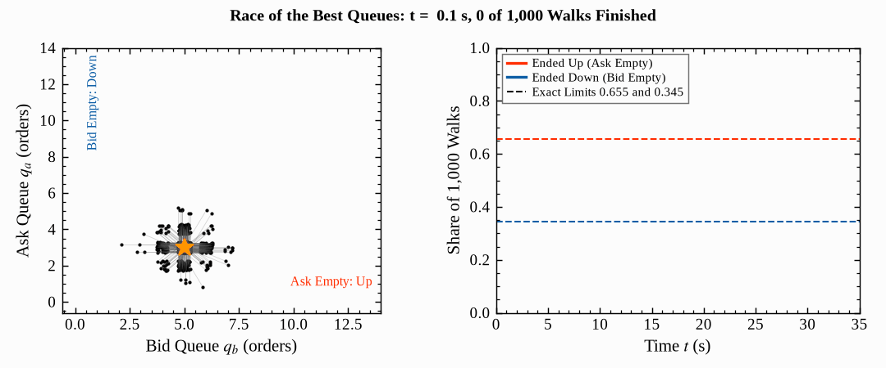 | 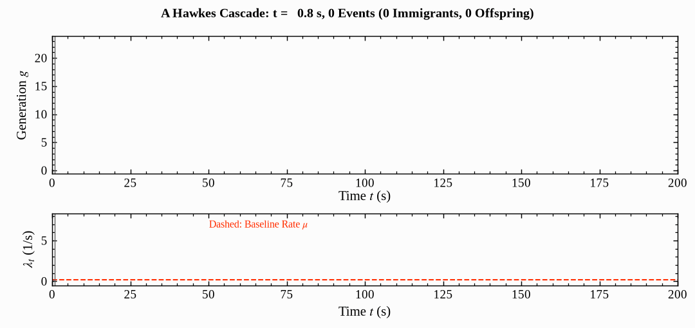 |
| *1,000 copies of the best queues start from 5 bids and 3 asks and walk until one queue empties. The share that ends with a price rise climbs to the exact Cont-de Larrard probability, 0.655.* | *A Hawkes process in its cluster form: immigrants arrive at a constant rate, every event can trigger children, and the intensity jumps and decays.* |
| 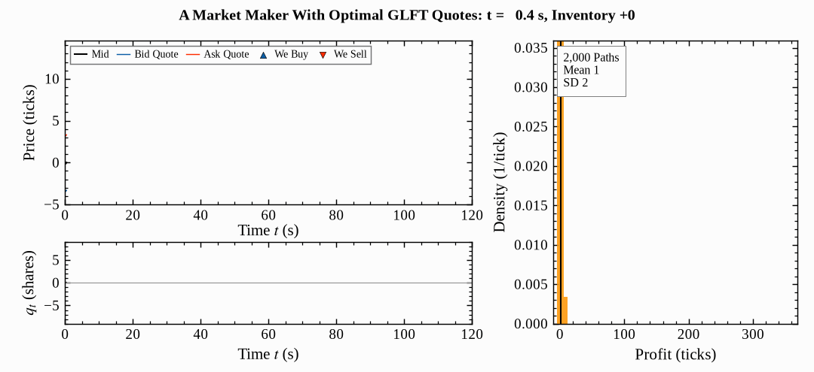 | 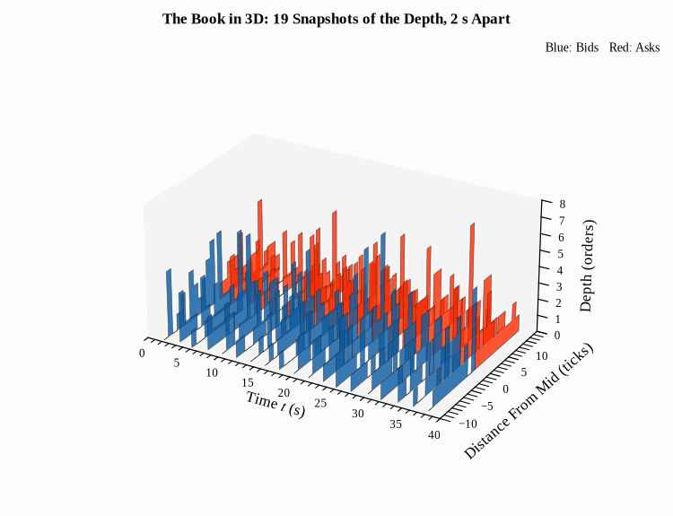 |
| *A market maker with optimal GLFT quotes: quotes skew with inventory around a random mid, fills arrive at random, and the profit across 2,000 paths drifts up while it spreads out.* | *The book in 3D: 19 snapshots of the depth profile, two seconds apart, turning in space.* |

One gallery figure per topic, mixing 3D views with 2D path plots:

| | |
|:---:|:---:|
| 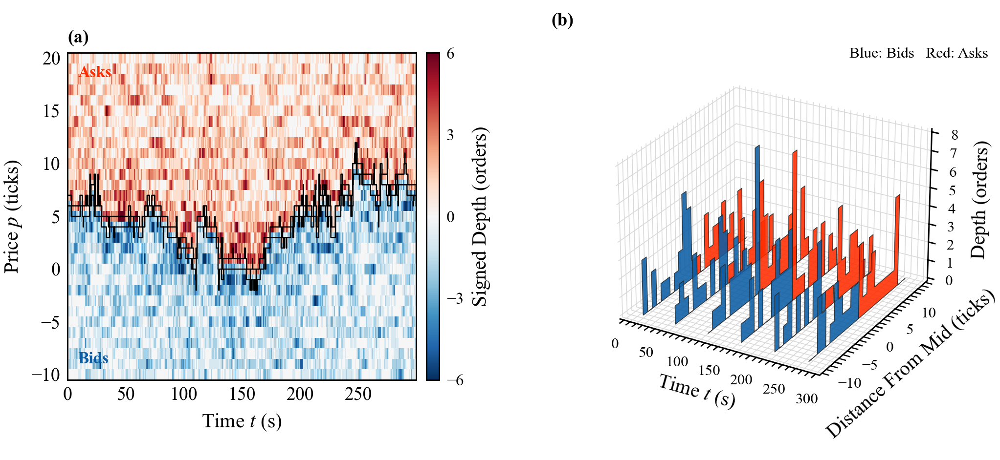 | 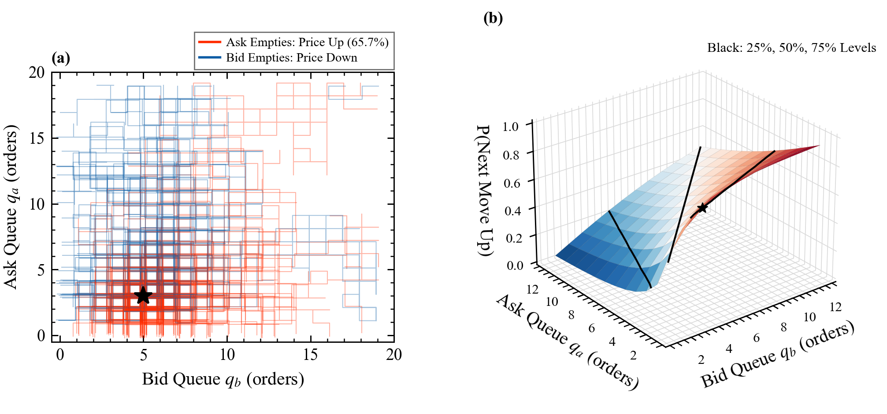 |
| *1. A liquidity map of a simulated book over 300 s, and the depth profile at six times.* | *2. Walks of the two best queues until one empties, and the exact probability that the next move is up.* |
| 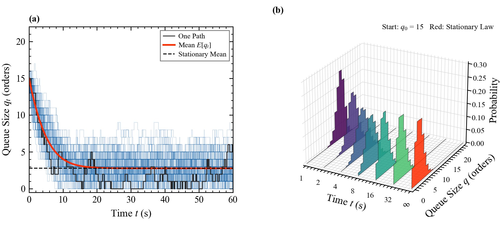 | 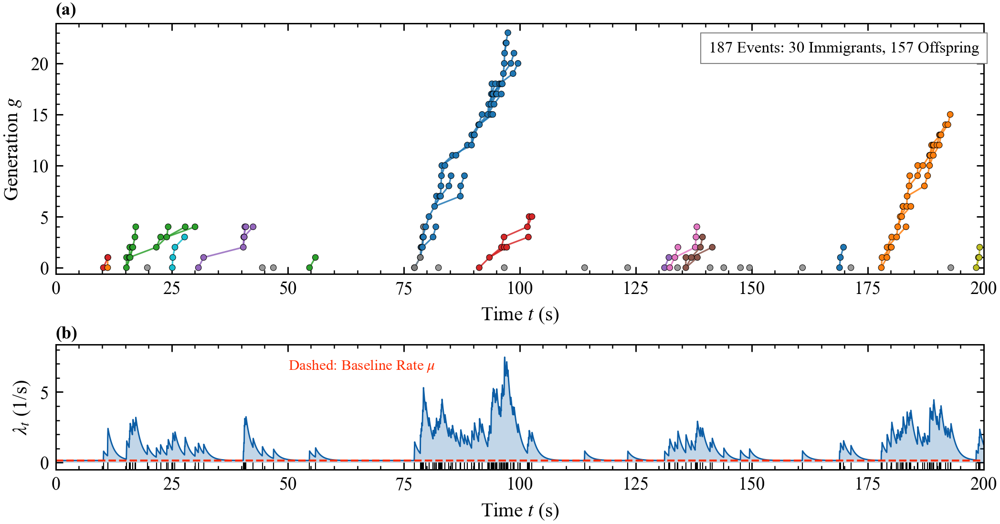 |
| *3. Queue-size paths from a long queue, and its law relaxing to the stationary one.* | *4. The branching cascade of one Hawkes path, and its intensity.* |
| 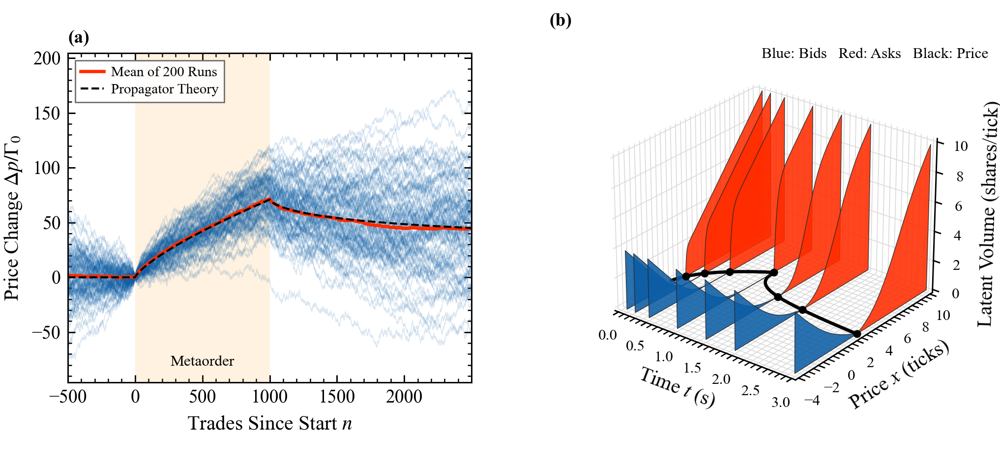 | 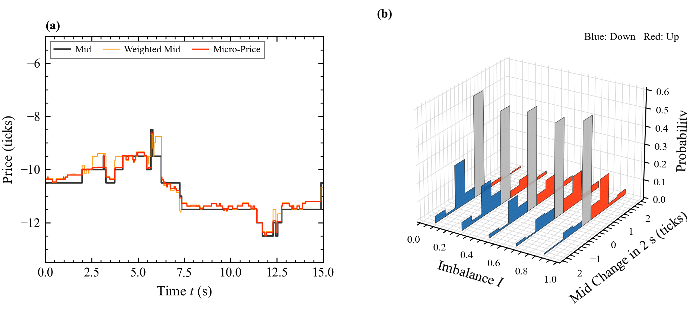 |
| *5. Noisy impact paths of a metaorder around the propagator mean, and the latent order book during and after a metaorder.* | *6. Mid, weighted mid and micro-price, and the law of the next mid change by queue imbalance.* |
| 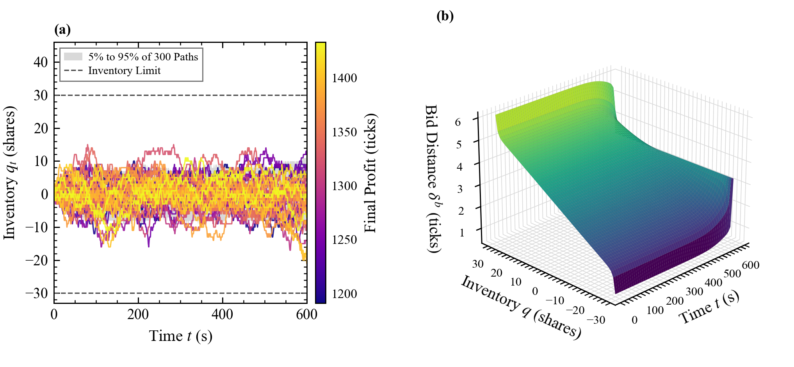 | 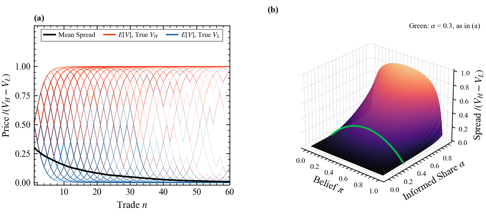 |
| *7. Inventory paths coloured by final profit, and the exact GLFT bid surface.* | *8. Glosten-Milgrom beliefs converging to the true value, and the spread surface.* |
| 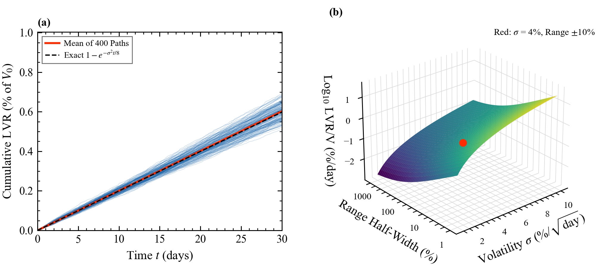 | |
| *9. Loss-versus-rebalancing paths of a constant-product pool, and LVR per unit capital over volatility and range width.* | |

## Results that are new in this repository

Small, checkable results produced by the code here. They are not claims about any market.

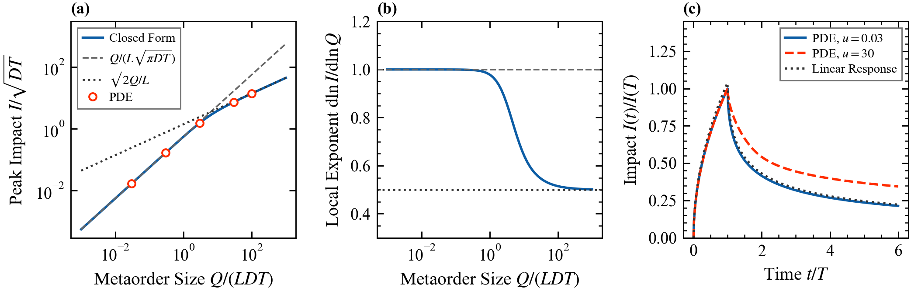

*Metaorder impact in the latent order book. (a) Peak impact against metaorder size, from linear to square root, with a closed form derived here and a finite-difference solution of the model's PDE (within 0.8%). (b) The local exponent falls from 1 to 1/2. (c) Impact decays after execution; slow execution follows the linear-response formula.*

- **Latent order book, exact crossover.** For a metaorder at constant rate, the price follows $y_t = \sqrt{Dt}\,F(u)$ with $u = m/(LD)$, and $F$ solves a one-line integral equation. Its limits give linear impact $Q/(L\sqrt{\pi DT})$ and square-root impact $\sqrt{2Q/L}$; they cross at $u = 2\pi$. The PDE agrees within 0.8%.
- **Branching ratios are easy to misread.** A Hawkes process with a power-law-like kernel and $n = 0.9$, fitted with one exponential, gives $\hat n \approx 0.43$ at every window from 1 minute to 8 hours. Pure Poisson data with a U-shaped intraday rate give $\hat n = 0.919 \pm 0.001$; after a time change by the estimated profile, $0.014 \pm 0.008$.
- **Queue position value with informed sweeps.** Joining behind 10 orders in a 16-order queue has negative expected markout per fill.
- **Toxicity without information.** In a zero-intelligence book, fills that empty the queue keep $0.04 \pm 0.01$ ticks, against $0.61$ for the others.
- **Fill-curve estimation matters.** Ignoring censoring nearly halves the estimated decay $k$ (0.165 against 0.3); exact quotes built on it lose $249.5 \pm 1.8$ ticks of certainty equivalent out of 1292.5.
- **Signal shrinkage.** A 60-second drift signal used raw in the permanent-drift solution loses $54.6 \pm 2.9$ ticks of certainty equivalent; shrunk to a quarter it gains $10.2 \pm 1.0$.
- **Concentrated liquidity.** Loss-versus-rebalancing per unit capital on $[P/w, Pw]$ is $\sigma^2/(8(1-w^{-1/2}))$; a ±10% range pays 21.5 times the full-range rate.
- **Statistics traps, shown on simulated data:** binomial errors on conditional frequencies (topic 2), propagator truncation bias (topic 5), depth truncation (topic 1), overlapping forecast horizons (topic 6).

## Verification

| Result | Check | Agreement |
|---|---|---|
| Cont-de Larrard P(up move) | Monte Carlo and exact sparse solve | within 2.4 s.e.; 2 × 10⁻³ |
| State-dependent P(up) in a simulated book | clustered s.e. | within 2.1 s.e. |
| Queue-reactive stationary law | long simulation | total variation 0.003 |
| Book rate MLE, queue-reactive intensity MLE | known truth | within 2.5 and 2.4 s.e. |
| Hawkes MLE, 10 parameters; signature plot | known truth; 42 points | within 2.2 and 3.1 s.e. |
| Propagator: critical exponent; Toeplitz estimate | fitted slope; known kernel | −0.007 ± 0.008 (theory 0); $\hat\zeta = 0.251 \pm 0.004$ (true 0.25) |
| Latent book closed form $F(u)$ | finite-difference PDE | within 0.8% |
| Queue value (absorbing chain) | Monte Carlo; truncation | within 4 s.e.; 10⁻³ |
| Exact GLFT quotes | ODE residual; closed form near zero inventory | < 10⁻⁶; 0.001 ticks |
| LVR, constant product and concentrated | Monte Carlo | within 4 s.e.; 2% |

s.e.: standard error. The exact numbers regenerate in [`results/`](results/) on every run, and the slides read them from there.

## Quick start

```bash
git clone https://github.com/syaohui/stochastic_limit_order_book.git
```

```bash
pip install -e ".[test]"
```

```python
from stochastic_lob import best_queues, latent_book, market_making as mm

# Probability that the next mid-price move is up, 2 orders at the bid and 5 at the ask
print(best_queues.p_up_balanced(q_b=2, q_a=5))                    # 0.244

# Peak impact (ticks) of Q = 100 shares over T = 1 s in a latent book with L = D = 1
print(latent_book.impact_peak(Q=100.0, T=1.0, L=1.0, D=1.0))      # 13.93, near sqrt(2Q/L) = 14.14

# Exact optimal bid and ask distances (ticks) with an inventory limit of 30
p = mm.MMParams(S0=0, T=600, sigma=0.3, dt=1, gamma=0.01, k=0.3, A=0.9)
bid, ask = mm.glft_exact_quotes(Q=30, p=p, taus=[600.0])
print(bid[0, 30], ask[0, 30])                                       # 3.313 3.313 at zero inventory
```

## Reproduce everything

```bash
python -m pytest tests
```

```bash
python experiments/run_all.py
```

```bash
python build_slides.py
```

```bash
python experiments/animations.py
```

46 tests (under a minute; each test file also runs on its own without pytest). 23 experiments and the gallery (about 15 minutes on a laptop, fixed seeds) write every figure to `figures/` and every number to `results/`. The five GIFs take a few minutes of CPU time. `build_slides.py` compiles the overview and the nine deep dives; it needs LaTeX with `latexmk` and the Metropolis Beamer theme. Details: [docs/reproducibility.md](docs/reproducibility.md).

## Run it on real data

```bash
python examples/lobster_pipeline.py MESSAGE.csv ORDERBOOK.csv --out report
```

Estimates book rates, P(up | queues), a Hawkes model of market orders, OFI regressions, the micro-price and markouts from one LOBSTER day, each with standard errors. Add `--simulate` instead of the file names to try it on a simulated day. See [docs/data.md](docs/data.md) for the format and the caveats.

## Repository layout

```
stochastic-lob/
├── slides/
│   ├── stochastic-lob-slides.pdf   overview deck (65 slides)
│   ├── decks/                      the nine deep-dive PDFs
│   ├── main.tex, parts/            overview deck source
│   ├── topics/                     deep-dive sources t1 to t9
│   ├── preamble.tex                shared style; reads results/*.tex
│   └── refs.bib                    verified references
├── src/stochastic_lob/             one module per topic (NumPy, SciPy)
│   ├── markov_lob.py               zero intelligence, CST book, rate MLE
│   ├── best_queues.py              Cont-de Larrard
│   ├── queue_reactive.py           Huang-Lehalle-Rosenbaum: Model I, estimation, Model III
│   ├── hawkes.py                   Hawkes processes, slow kernels, seasonality
│   ├── impact.py                   propagator and its estimation; OFI
│   ├── latent_book.py              latent order book: closed form and PDE
│   ├── microprice.py               Stoikov micro-price
│   ├── market_making.py            AS, exact GLFT, signals, fill-curve estimation
│   ├── adverse_selection.py        Glosten-Milgrom
│   ├── queue_position.py           fill probability and value by queue position
│   ├── markouts.py                 markouts of passive fills
│   ├── amm.py                      loss-versus-rebalancing
│   └── lobster.py                  LOBSTER data format
├── experiments/                    e1 to e23 (one script per figure), gallery.py, animations.py, run_all.py
├── tests/                          46 checks against independent results
├── examples/lobster_pipeline.py    all estimators on one LOBSTER day
├── docs/                           topic pages, API, data, reproducibility, reading list
├── notebooks/tour.ipynb            short worked examples
├── figures/                        generated figures (PNG); gallery/ and animations/ (GIF)
├── results/                        generated numbers (JSON and LaTeX macros)
└── build_slides.py                 compiles all decks
```

## Conventions

Time is in seconds and sizes are unit orders, unless a page says otherwise. Prices are in ticks in the queueing models and in ticks or price units in the market-making models, as stated. Every symbol is defined where it first appears. Where a code name differs from the slide symbol, the module docstring gives the mapping.

## Contributing, citing, licence

- Contributions: see [CONTRIBUTING.md](CONTRIBUTING.md). A new model needs a module, an independent test, and an experiment that writes its figure and numbers.
- Citing: use [`CITATION.cff`](CITATION.cff); GitHub shows a "Cite this repository" button.
- Licence: MIT, see [`LICENSE`](LICENSE).

Research and teaching code. It is not trading software, and nothing here is investment advice.
