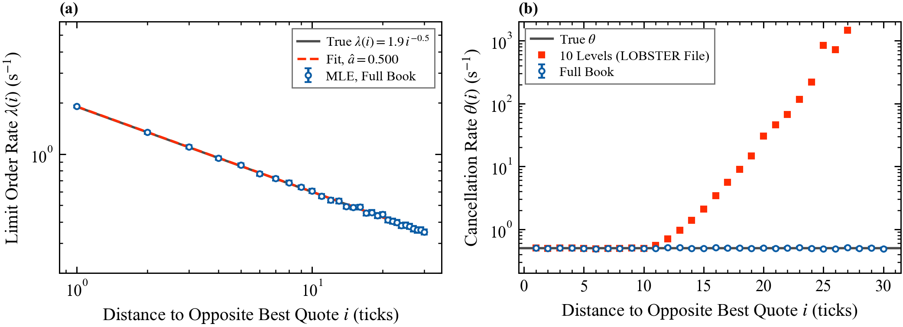

# 1. Zero intelligence and the Markovian order book

Deck: [`slides/decks/01-markovian-order-book.pdf`](../../slides/decks/01-markovian-order-book.pdf) · Code: [`markov_lob.py`](../../src/stochastic_lob/markov_lob.py), [`lobster.py`](../../src/stochastic_lob/lobster.py) · Experiments: `e1_markov_book.py`, `e15_rate_estimation.py`

## The question

Can order flow with no strategy at all explain the shape of the book, the spread, and the speed of price moves? If it can, the book's statics are set by a few rates. If it cannot, the gap shows where strategy and information matter. For a liquidity provider (LP) the model is a null hypothesis: the fill probabilities and spreads to expect before any signal or toxicity.

## Model

Prices sit on a grid with tick $\delta$ (currency). The state $X_p(t)$ is the signed number of unit orders resting at price $p$ (ticks), positive for asks. Write $p_B$ and $p_A$ for the best bid and ask, and $s = p_A - p_B$ for the spread (ticks). For an order at distance $i \ge 1$ ticks from the opposite best quote:

| Event | Rate | Unit |
|---|---|---|
| limit buy at $p_A - i$ (sell at $p_B + i$) | $\lambda(i)$ | orders/s |
| market buy (sell): one order removed at $p_A$ ($p_B$) | $\mu$ | orders/s |
| cancellation of one resting order at distance $i$ | $\theta(i)$ per order | 1/s |

- Zero intelligence (Smith et al. 2003): $\lambda$ and $\theta$ constant over $L$ ticks.
- Cont, Stoikov and Talreja (2010): $\lambda(i) = \lambda_1 i^{-a}$, with $\lambda_1$ (1/s) the rate one tick away and $a$ a dimensionless exponent.

Given the state, all events are independent Poisson streams, so $X$ is a continuous-time Markov chain. `simulate_markov_lob` simulates it exactly with the Gillespie algorithm.

## What it predicts

- **Far depth.** A level that market orders rarely reach is an M/M/∞ queue, so its mean depth tends to $\lambda(i)/\theta(i)$ orders. Near the quotes, market orders thin the book below this value.
- **Dimensional analysis.** In ticks and orders, stationary statistics depend only on $\lambda/\theta$ (depth scale), $\mu/\lambda$ (price scale, ticks) and $L$.
- **Conditional probabilities.** Cont, Stoikov and Talreja compute, by Laplace transforms of first-passage times, the probability of an up move and of execution before a price change. The same first-passage problems appear in topic 2.

Assumptions: unit order size; rates depend on distance only; no memory; no information.

## Estimation

For a Markov jump process observed on $[0, T]$ the log-likelihood is

$$\ell = \sum_{\text{events } k} \ln r_{e_k}(X_{t_k^-}) - \int_0^T \sum_e r_e(X_t)\,\mathrm{d}t ,$$

with $r_e(x)$ the rate of event type $e$ in state $x$. It splits into Poisson problems with closed-form maximizers:

$$\hat\lambda(i) = \frac{N_L(i)}{2T}, \qquad \hat\theta(i) = \frac{N_C(i)}{E(i)}, \qquad \hat\mu = \frac{N_M}{2T},$$

where $N_L(i)$ and $N_C(i)$ count limit orders and cancellations at distance $i$ on both sides, $N_M$ counts market orders, and $E(i) = \int_0^T (\text{orders at distance } i)\,\mathrm{d}t$ is the exposure in order-seconds. Standard errors are $\sqrt{N}$ divided by the denominator. Distances are measured against the quotes just before each event. `markov_lob.estimate_rates` implements this.

## Results in this repository

- Mean spread $1.226 \pm 0.006$ ticks for the power-law book and $2.610 \pm 0.028$ for zero intelligence, over 300,000 events each (E1).
- Rate recovery (E15): 300,000 events, written to and read back from LOBSTER files. Every $\hat\lambda(i)$ is within 2.5 standard errors of the truth; the fitted exponent is $\hat a = 0.500 \pm 0.002$ (true 0.5); $\hat\mu = 1.005 \pm 0.011$ (true 1).
- **Depth-truncation bias.** A 10-level file shows about 13 ticks of book. Cancellation messages still arrive from beyond, but their exposure is invisible, so $\hat\theta(i)$ is biased from $i = 11$ on (figure 15b). Cancellation rates need depth as deep as the distances you estimate.

## What published research reports

- On the Paris Bourse (France Telecom, Vivendi, Total; February 2001), new limit orders are placed at distances that follow a power law with exponent about 0.6, and the average book is hump-shaped (Bouchaud, Mézard and Potters 2002).
- For 11 London Stock Exchange stocks, the zero-intelligence model with measured rates explains 96% of the variance of the mean spread and 76% of the variance of the price diffusion rate across stocks (Farmer, Patelli and Zovko 2005).
- Cont, Stoikov and Talreja (2010) fit the model to Tokyo Stock Exchange data. Gould et al. (2013) survey the stylized facts.

## Where it fails

Intensities depend on queue sizes (topic 3), order signs have long memory (topic 5), events cluster in time (topic 4), and there is no information. Even so, fills that empty a queue are followed by adverse moves (topic 8): queue mechanics alone create toxicity.

## For a liquidity provider

1. Use the fitted model as a baseline for fill probabilities and spreads.
2. Estimate cancellation rates with exposure, not counts per second.
3. Check how deep your data see before trusting rates far from the touch.
4. Report standard errors; the Poisson likelihood gives them directly.

## Open questions

How much of today's cross-section of spreads and volatility do rate-only models still explain, in fragmented high-frequency markets? Which state variables should enter the rates first?
