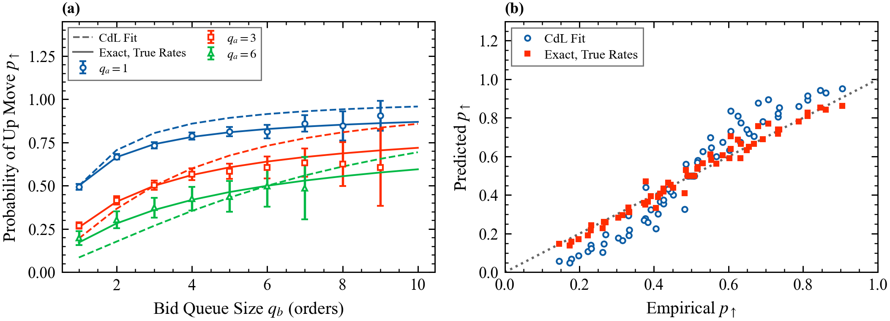

# 2. The best queues (Cont and de Larrard)

Deck: [`slides/decks/02-best-queues.pdf`](../../slides/decks/02-best-queues.pdf) · Code: [`best_queues.py`](../../src/stochastic_lob/best_queues.py), `queue_position.p_up_state_dependent`, `markov_lob.empirical_p_up` · Experiments: `e2_best_queues.py`, `e23_cdl_on_book.py`

## The question

In a liquid large-tick stock almost all activity is at the best bid and ask. Can two queues explain the direction of the next price move, the time until it happens, and the volatility over minutes? For an LP, the direction is the chance a resting quote turns stale, and the timing is how long it stays exposed.

## Model

The spread is one tick. The bid queue $q_b$ and ask queue $q_a$ (orders) move independently: $q \to q + 1$ at rate $\lambda$ and $q \to q - 1$ at rate $\nu = \mu + \theta$, where $\lambda$, $\mu$ and $\theta$ (1/s) are the limit order, market order and cancellation rates, constant and not per order. When the ask empties the price rises one tick $\delta$; when the bid empties it falls. Both queues are then redrawn from a distribution $f$.

## Results

A queue of size $q$ hits zero at time $\tau_q$ (s) with density

$$f_q(t) = \frac{q}{t}\left(\frac{\nu}{\lambda}\right)^{q/2} I_q\!\left(2\sqrt{\lambda\nu}\,t\right) e^{-(\lambda+\nu)t},$$

with $I_q$ the modified Bessel function of the first kind. Because the queues are independent,

$$p_\uparrow(q_b, q_a) = \int_0^\infty f_{q_a}(t)\,P(\tau_{q_b} > t)\,\mathrm{d}t, \qquad P(\tau > t) = P(\tau_{q_b} > t)\,P(\tau_{q_a} > t).$$

- **Balanced case** $\lambda = \nu$, large queues: $p_\uparrow \approx \frac{2}{\pi}\arctan(q_b/q_a)$, from planar Brownian motion stopped on the axes.
- **Heavy tail:** $P(\tau > t) \approx q_b q_a/(\pi\lambda t)$, so the mean time between moves is infinite.
- **Volatility:** with $M_F = \sum_{x,y} xy\,f(x,y)$ (orders²), the number of moves by time $t$ grows like $\pi\lambda t/(M_F\ln(\lambda t))$, so the price variance per unit time scales as $\pi\lambda\delta^2/M_F$ up to a logarithm. Cont and de Larrard prove the diffusion limit on the time scale $t\,n\ln n$. This repository does not check the diffusion limit numerically.

## Statistics

Fit $\hat\lambda$ and $\hat\nu$ from one-tick-spread periods: joins and departures at the best queues divided by twice the time. Test $\hat p_\uparrow$ against the empirical frequency of up moves given $(q_b, q_a)$.

**Samples are not independent.** If every book event is a sample, all samples between two price moves share one outcome, and most events happen far from the touch. Binomial standard errors are then much too small. `empirical_p_up` returns errors clustered by price-move spell:

$$\widehat{\mathrm{Var}}(\hat p) = \frac{1}{n^2}\sum_{c}\Big(\sum_{i\in c}(y_i - \hat p)\Big)^2,$$

with $y_i \in \{0, 1\}$ the outcome of sample $i$ and $c$ the clusters.

## Results in this repository

- Closed forms against Monte Carlo (E2): within 2.4 standard errors, 20,000 paths per point; an exact sparse linear solve agrees to $2\times10^{-3}$; the duration tail is within 0.88% of the exact survival at $10^4$ s.
- **Fitting constant rates to a book whose rates are not constant** (E23). In the power-law Markovian book of topic 1, best queues shrink at $\mu + \theta q$. Over 1,500,000 events and 34,204 mid moves, the fitted constant-rate model is off by 0.089 on average across 64 cells (worst 0.23). The exact answer for the true state-dependent rates is off by 0.023, within 2.1 clustered standard errors. With binomial errors the same exact model looked rejected at more than 15 standard errors.

## What published research reports

Cont and de Larrard (2013), NYSE stocks on 26 June 2008: the spread was one tick in 98.82% of observations for Citigroup, 98.80% for General Electric and 98.71% for General Motors. The limit order rate was slightly below the rate of market orders plus cancellations. After an up move the new bid queue was usually smaller than the new ask queue (for Citigroup the relevant probability exceeded 0.7), which makes increments negatively correlated. Across Dow Jones stocks, the standard deviation of 10-minute price changes rose roughly in proportion to the model's rate-over-depth ratio.

## For a liquidity provider

- $p_\uparrow$ is the probability that a resting bid becomes stale; use the state-dependent version when cancellations scale with queue size.
- A $1/t$ duration tail means occasional very long exposures.
- Conditional frequencies from tick data need clustered errors.

## Open question

A tractable model with history and state dependence that keeps closed forms for $p_\uparrow$.
