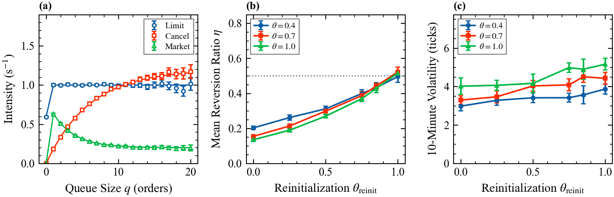

# 3. Queue-reactive models

Deck: [`slides/decks/03-queue-reactive-models.pdf`](../../slides/decks/03-queue-reactive-models.pdf) · Code: [`queue_reactive.py`](../../src/stochastic_lob/queue_reactive.py) · Experiments: `e3_queue_reactive.py`, `e16_queue_reactive_price.py`

## The question

Traders look at the queue before they act. What happens if every intensity is a function of the size of the queue it acts on? Huang, Lehalle and Rosenbaum (HLR, 2015) build the model, estimate it nonparametrically, and add a reference price.

## Model I

Queue size $q$ is measured in average event sizes (AES) at that level. Each level is a birth-death chain:

$$q \to q + 1 \text{ at } \lambda^L(q), \qquad q \to q - 1 \text{ at } \lambda^C(q) + \lambda^M(q),$$

limit orders, cancellations and market orders (1/s), with $\lambda^C(0) = \lambda^M(0) = 0$. If the sum converges, detailed balance gives

$$\pi(q) = \pi(0)\prod_{j=1}^{q}\frac{\lambda^L(j-1)}{\lambda^C(j) + \lambda^M(j)} .$$

The Poisson model of topic 1 is the special case $\lambda^L$ constant, $\lambda^C(q) = \theta q$, $\lambda^M$ constant.

## Estimation

With $\tau(n)$ the total time (s) at size $n$ and $N_x(n)$ the number of type-$x$ events at size $n$,

$$\hat\lambda^x(n) = \frac{N_x(n)}{\tau(n)}, \qquad \text{s.e.} = \frac{\sqrt{N_x(n)}}{\tau(n)}, \qquad x \in \{L, C, M\}.$$

This is HLR's estimator in exposure form. The last spell is censored and adds exposure without an event. `estimate_intensities` implements it.

## Model III (reduced)

Queues sit at $p_{\mathrm{ref}} \pm (i - \tfrac12)\delta$. When a best queue empties, $p_{\mathrm{ref}}$ moves one tick away from it with probability $\theta$; the queues shift so that the emptied level becomes the new best queue on the other side, initially empty. With probability $\theta_{\mathrm{reinit}}$ the book is then redrawn from its stationary law, a stand-in for news.

The mean reversion ratio of Robert and Rosenbaum (2011) is $\eta = N_c/(2N_a)$, with $N_c$ continuations and $N_a$ alternations of consecutive price moves: $\eta = 1/2$ for independent moves, $\eta < 1/2$ for mean reversion.

`simulate_model3` reduces HLR's version: two levels per side, unit events, Model I dynamics between moves, and moves triggered only by depletions. Market orders reach the second level only while the best level on that side is empty.

## Results in this repository

- Product formula against a simulated queue (E3): total variation distance 0.0031 over 314,592 events.
- Intensity recovery (E16a): 386,562 events; every intensity with at least 30 events at its size is within 2.4 standard errors.
- Model III (E16b, c), $2\times10^5$ s per point, batch-means errors. With $\theta_{\mathrm{reinit}} = 0$ the price mean-reverts strongly: $\eta = 0.15$ at $\theta = 0.7$ and $0.14$ at $\theta = 1$. At HLR's calibration $\theta_{\mathrm{reinit}} = 0.85$, $\eta = 0.44$, and the 10-minute volatility rises from 3.29 to 4.51 ticks although moves are fewer (41 to 22 per 10 minutes).

Why: right after an up move the new bid queue is empty and the new ask queue is the old second level, often long. The imbalance points down.

## What published research reports

HLR (2015), Euronext Paris, January 2010 to March 2012, France Telecom and Alcatel-Lucent (large tick); France Telecom averaged about 159,000 orders and 7,300 trades a day.

- Limit order insertion at the best is roughly flat in queue size, lower at zero. At the second level it decreases with queue size: traders post there to gain priority while the queue is short.
- Cancellation at the best rises concavely up to about 25 AES and then flattens, unlike linear Poisson cancellation.
- Market order intensity decays exponentially with the best queue size.
- Model III calibrated to $\theta = 0.7$, $\theta_{\mathrm{reinit}} = 0.85$. With $\theta_{\mathrm{reinit}} = 0$, the largest volatility the book alone produces is about 5 bp over 10 minutes against 14 bp observed, and $\eta = 0.08$ against an empirical 0.39.
- A Poisson model with linear cancellation overestimates execution probabilities.

## For a liquidity provider

- Compute fill probabilities with measured, state-dependent intensities; linear cancellation is too optimistic.
- $\theta_{\mathrm{reinit}}$ measures the share of price moves not explained by the book: how much of inventory risk is news.

## Open question

State-plus-history intensities with order sizes (Wu et al. 2019 add Hawkes terms), and whether $\theta_{\mathrm{reinit}}$ is stable across days.
