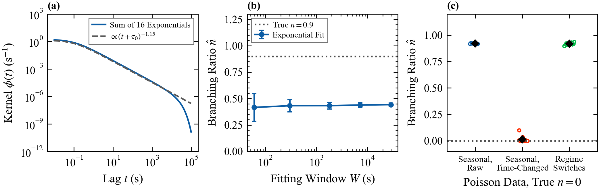

# 4. Self-exciting order flow (Hawkes processes)

Deck: [`slides/decks/04-hawkes-order-flow.pdf`](../../slides/decks/04-hawkes-order-flow.pdf) · Code: [`hawkes.py`](../../src/stochastic_lob/hawkes.py) · Experiments: `e4_hawkes.py`, `e5_signature.py`, `e17_hawkes_pitfalls.py`

## The question

How much of market activity is triggered by market activity? The branching ratio of a Hawkes process measures it. Near-critical excitation also links millisecond order flow to rough volatility over hours.

## Model

For event types $u, v$ with event times $t^v_j$, the intensity (1/s) is

$$\Lambda_u(t) = \Lambda^0_u + \sum_v \sum_{t^v_j < t} \phi_{uv}(t - t^v_j),$$

with baseline $\Lambda^0_u$ (1/s) and kernels $\phi_{uv} \ge 0$ (1/s). Let $G_{uv} = \int_0^\infty \phi_{uv}$ (dimensionless). Each type-$v$ event has on average $G_{uv}$ direct children of type $u$. The process is stationary if and only if the spectral radius $\rho(G) < 1$, and then $\bar\Lambda = (I - G)^{-1}\Lambda^0$. In one dimension $n = G$ is the branching ratio, the share of endogenous events.

- Exponential kernel $\phi(t) = \alpha e^{-\beta t}$ (jump $\alpha$, decay $\beta$, both 1/s): $n = \alpha/\beta$, and the likelihood takes one pass.
- Power-law kernel $\phi(t) \propto (t + \tau_0)^{-(1+\epsilon)}$, cut-off $\tau_0$ (s), tail exponent $\epsilon > 0$: memory over many time scales. `power_law_weights` approximates it by a sum of exponentials.

## Estimation and diagnostics

$$\ell = \sum_u\Big[\sum_j \ln\Lambda_u(t^u_j) - \int_0^T \Lambda_u(t)\,\mathrm{d}t\Big].$$

Standard errors come from the inverse observed information. Under the true model the compensator increments $\mathcal{A}_u(t^u_j) - \mathcal{A}_u(t^u_{j-1})$, with $\mathcal{A}_u(t) = \int_0^t\Lambda_u$, are i.i.d. unit exponential; a Kolmogorov-Smirnov test checks them.

## The Hawkes price and the signature plot

Up and down ticks with self jump $\alpha_s$, cross jump $\alpha_c$ and common decay $\beta$ (Bacry et al. 2013). With $g = (\alpha_s - \alpha_c)/\beta$, $\eta_H = \beta(1 - g)$ and mean rate per side $\bar\Lambda$, the realized variance per unit time at sampling interval $h$ (s) is

$$C(h) = 2\bar\Lambda\Big[\tfrac{1}{(1-g)^2} + \Big(1 - \tfrac{1}{(1-g)^2}\Big)\tfrac{1 - e^{-\eta_H h}}{\eta_H h}\Big] \quad (\text{ticks}^2/\text{s}).$$

Cross-excitation makes $C(h)$ fall with $h$: bid-ask bounce.

## Results in this repository

- Bivariate fit (E4): all ten parameters within 2.23 standard errors; KS $p = 0.94$ and $0.99$.
- Signature plot (E5): simulation within 3.1 standard errors at 42 points.
- **Three ways to misread the branching ratio** (E17):
  1. *One-scale kernel.* Truth: a sum of 16 exponentials following $(t + \tau_0)^{-1.15}$ from 0.1 s to about $10^4$ s, $n = 0.9$. An exponential kernel fitted on windows from 1 minute to 8 hours gives $\hat n = 0.42 \pm 0.07$ to $0.44 \pm 0.01$, with decay time about 0.3 s. It misses more than half the excitation at every window length.
  2. *Seasonality.* Pure Poisson data ($n = 0$) with a U-shaped intraday rate, 12 days: $\hat n = 0.919 \pm 0.001$, through a slow exponential (decay time near 100 s) that mimics the rate swing. After a time change by the estimated 30-minute profile: $\hat n = 0.014 \pm 0.008$.
  3. *Regime switches.* Poisson data whose rate jumps between two levels: $\hat n = 0.919 \pm 0.003$.

## What published research reports

- E-mini S&P 500 futures mid-price changes, 1998 to 2011: a power-law kernel with exponent near $-1.15$ below $10^3$ s and near $-1.45$ from $10^3$ to $10^6$ s integrates to about one in every two-month period (Hardiman, Bercot and Bouchaud 2013). Exponential fits on 30-minute windows of synthetic critical data give sub-critical values.
- Regime shifts and outliers bias $\hat n$ upward; Poisson data with regime changes give $n \approx 1$ (Filimonov and Sornette 2015).
- Nonparametric estimation finds slowly decaying kernels from about 10 μs to 100 s in an eight-dimensional book model (Bacry, Jaisson and Muzy 2016).
- Nearly unstable Hawkes processes have diffusive scaling limits (Jaisson and Rosenbaum 2015); with heavy-tailed kernels the limits are rough, and with no-arbitrage and metaorder splitting they give the rough Heston model with leverage (El Euch, Fukasawa and Rosenbaum 2018).

## For a liquidity provider

Fit kernels with many time scales; remove seasonality first; test residuals; distrust a branching ratio near one until regime changes are ruled out.
