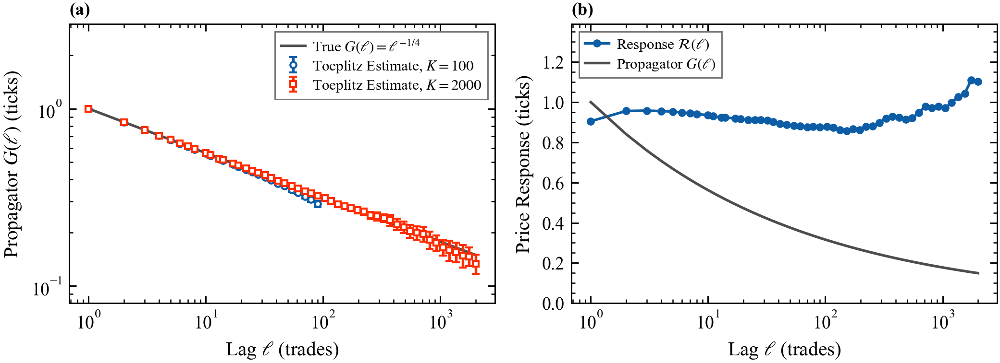
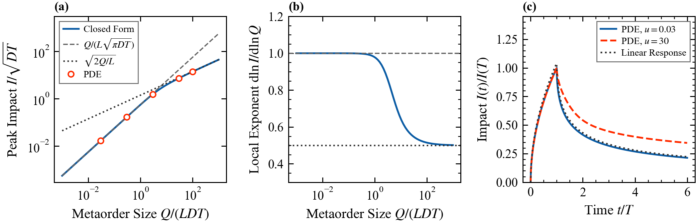

# 5. Price impact: propagators, the square-root law, and the latent order book

Deck: [`slides/decks/05-price-impact.pdf`](../../slides/decks/05-price-impact.pdf) · Code: [`impact.py`](../../src/stochastic_lob/impact.py), [`latent_book.py`](../../src/stochastic_lob/latent_book.py) · Experiments: `e6_propagator.py`, `e18_propagator_estimation.py`, `e19_latent_book.py`

## The question

Trades move prices. How much, for how long, and why is impact concave in size? Two facts must coexist. Trade signs $\varepsilon_n = \pm1$ (trade time $n$) have long memory, $C_\varepsilon(\ell) = \mathbb{E}[\varepsilon_n\varepsilon_{n+\ell}] \sim \ell^{-\gamma_\varepsilon}$ with $0 < \gamma_\varepsilon < 1$. Yet prices are close to unpredictable, and a metaorder of $Q$ shares moves the price by about $Y\sigma_D\sqrt{Q/V_D}$, with daily volatility $\sigma_D$, daily volume $V_D$ and $Y$ of order one.

## The propagator model

The price just before trade $n$ (ticks) is

$$P_n = \sum_{m<n} G(n - m)\,\varepsilon_m + \text{noise}, \qquad G(\ell) = \Gamma_0\ell^{-\zeta},$$

with impact one trade later $\Gamma_0$ (ticks) and decay exponent $\zeta$ (Bouchaud et al. 2004). The variance per trade over $\ell$ trades scales as $\ell^{1 - \gamma_\varepsilon - 2\zeta}$, so prices diffuse only at $\zeta_c = (1 - \gamma_\varepsilon)/2$.

## Estimating the propagator

Differencing gives $\Delta P_n = \sum_{k\ge0} g_k\varepsilon_{n-k} + \xi_n$ with $g_0 = G(1)$, $g_k = G(k+1) - G(k)$ and noise $\xi_n$ uncorrelated with past signs. Multiplying by $\varepsilon_{n-j}$ and averaging gives a Toeplitz system,

$$\sum_{k=0}^{K-1} C_\varepsilon(|j-k|)\,g_k = \mathbb{E}[\Delta P_n\,\varepsilon_{n-j}], \qquad j = 0,\dots,K-1,$$

and $G(\ell) = \sum_{k<\ell} g_k$. `estimate_propagator` solves it with FFT correlations; `block_bootstrap` gives errors.

Two warnings, both shown in E18:

- **Truncation bias.** Lags beyond $K$ are left out, and long-memory signs correlate them with the lags kept. With $K = 100$, $\hat G(100) = 0.272$ against the true 0.316, and $\hat\zeta = 0.288 \pm 0.006$ (true 0.25). With $K = 2000$: $\hat G(100) = 0.314 \pm 0.005$ and $\hat\zeta = 0.251 \pm 0.004$.
- **Response is not impact.** The response function $\mathcal{R}(\ell) = \mathbb{E}[\varepsilon_n(P_{n+\ell} - P_n)]$ stays near one tick (0.91 at lag 1, at most 1.11) while $G$ falls to 0.15 at lag 2000.

## The latent order book (derived here)

Donier et al. (2015) model the latent book: intentions to trade, revealed as the price approaches. Latent bid and ask densities $b(x,t)$, $a(x,t)$ (shares per tick) at price $x$ (ticks) diffuse with coefficient $D$ (ticks²/s) and annihilate on contact. With $\phi = b - a$, a buy metaorder at rate $m(t)$ (shares/s), price $y_t$ and Dirac delta $\delta_D$:

$$\partial_t\phi = D\,\partial_x^2\phi + m(t)\,\delta_D(x - y_t), \qquad \phi(y_t, t) = 0, \qquad \phi(x, 0) = -Lx,$$

with $L$ (shares/tick²) the slope of the latent book. This is the simplest version, with no deposition and no cancellation.

**Units first.** The only dimensionless group is $u = m/(LD)$. For constant $m$ the problem has no time scale, so $y_t = \sqrt{Dt}\,F(u)$.

**Closed form.** The equation is linear in $\phi$, so $\phi = -Lx + m\int_0^t K_D(x - y_s, t - s)\,\mathrm{d}s$ with heat kernel $K_D(x,\tau) = e^{-x^2/4D\tau}/\sqrt{4\pi D\tau}$. Setting $\phi(y_t,t) = 0$ with $y_s = A\sqrt s$, substituting $s = tw$, $w = 1 - v^2$ and writing $a = A/\sqrt D$:

$$a = \frac{u}{\sqrt\pi}\int_0^1 \exp\!\Big(-\frac{a^2}{4}\,\frac{1 - \sqrt{1-v^2}}{1 + \sqrt{1-v^2}}\Big)\mathrm{d}v, \qquad F(u) = a .$$

The left side increases in $a$ and the right side decreases, so the root is unique. For $Q = mT$ shares executed over $T$ seconds:

- slow execution, $u \ll 1$: $a \to u/\sqrt\pi$ and $I = Q/(L\sqrt{\pi DT})$, linear in $Q$;
- fast execution, $u \gg 1$: $a \to \sqrt{2u}$ and $I = \sqrt{2Q/L}$, the square root, independent of $D$ and $T$.

The asymptotes cross at $u = 2\pi$. After a slow metaorder ends, $y_t = \frac{m}{L\sqrt{\pi D}}(\sqrt t - \sqrt{t - T})$: a propagator with exponent 1/2 in calendar time.

**Checks** (E19, `test_extensions.py`): a Crank-Nicolson solution of the PDE on 16,001 nodes agrees with $F(u)$ within 0.8% up to $u = 100$, with first-order convergence (1.5% at half resolution). The local exponent $\mathrm{d}\ln I/\mathrm{d}\ln Q$ falls from 1.000 to 0.501. At $t = 5T$ a slow metaorder keeps 0.24 of its peak impact (linear theory 0.24); a fast one keeps 0.37.

We have not checked whether this closed form for the crossover appears in the literature; Donier et al. give the two regimes.

## What published research reports

- Reported impact exponents range from 0.4 to 0.7. On about 700,000 US stock orders executed by Citigroup, Almgren et al. (2005) find a 3/5 power law. On nearly 500,000 futures trades, Tóth et al. (2011) find about 0.5 for small-tick and 0.6 for large-tick contracts, for $Q/V_D$ from a few $10^{-4}$ to a few percent.
- On the London Stock Exchange, order-sign autocorrelation decays roughly as $\ell^{-0.6}$ (Lillo and Farmer 2004).
- Limit orders and cancellations have impact too (Eisler, Bouchaud and Kockelkoren, arXiv:0904.0900).
- Exponential decay of impact is compatible only with linear impact (Gatheral 2010). The latent book model contains the propagator model and allows no price manipulation (Donier et al. 2015).

## For a liquidity provider

A fill in the middle of a metaorder is followed by more trades of the same sign; long-horizon markouts measure this. Impact decays, so part of the adverse move reverts. Estimate decay with the propagator system and a long truncation lag, not from the response function.

## Open questions

One mechanism for queue dynamics, sign memory and square-root impact; online inference of the latent book; the latent book with finite memory and its permanent impact.
