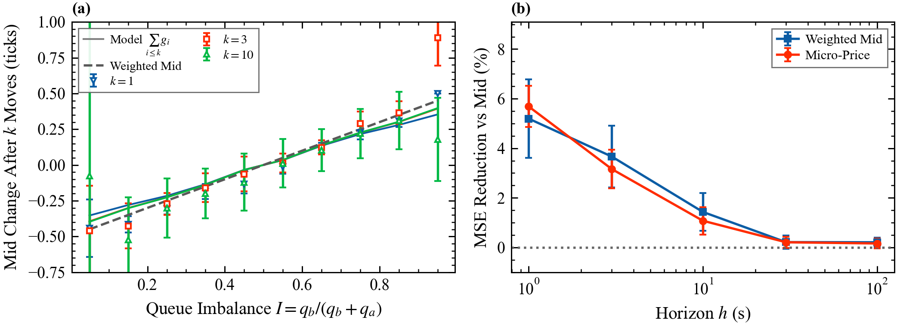

# 6. Order flow imbalance and the micro-price

Deck: [`slides/decks/06-order-flow-imbalance-microprice.pdf`](../../slides/decks/06-order-flow-imbalance-microprice.pdf) · Code: [`impact.py`](../../src/stochastic_lob/impact.py) (OFI), [`microprice.py`](../../src/stochastic_lob/microprice.py) · Experiments: `e8_ofi.py`, `e14_mlofi.py`, `e20_microprice.py`

## The question

Over seconds, prices move because best queues are added to and eaten. Which summary of order flow explains the move (contemporaneous), and which summary of the book predicts the next one (predictive)? An LP quotes around a fair value; quoting around the mid when the fair value is elsewhere hands edge to the next trader.

## Order flow imbalance (OFI)

From best-quote snapshots $n - 1 \to n$, with best bid and ask prices $p_B, p_A$ and sizes $q_b, q_a$ (Cont, Kukanov and Stoikov 2014):

$$e_n = \mathbf{1}_{\{p_{B,n}\ge p_{B,n-1}\}} q_{b,n} - \mathbf{1}_{\{p_{B,n}\le p_{B,n-1}\}} q_{b,n-1} - \mathbf{1}_{\{p_{A,n}\le p_{A,n-1}\}} q_{a,n} + \mathbf{1}_{\{p_{A,n}\ge p_{A,n-1}\}} q_{a,n-1}.$$

OFI over a window is the sum of $e_n$. If every level holds $\bar q$ orders, the mid change in ticks is $\Delta S/\delta \approx \kappa\,\mathrm{OFI}$ with $\kappa \approx 1/(2\bar q)$. Multi-level OFI applies the formula at each level (Xu, Gould and Howison 2019); integrated OFI combines depth-normalized level OFIs with first-principal-component weights (Cont, Cucuringu and Zhang 2023).

## Statistics

- **Tautology:** OFI includes the price-changing events. Cont, Kukanov and Stoikov re-estimate without them: $R^2$ falls from about 65% to 35% to 60%.
- **Heteroskedasticity:** use White errors; for regressions across windows of estimated coefficients, Newey-West errors.
- **Overlapping forecast horizons:** with one sample per event, effective sample size is closer to (sample length)/(horizon). Use block bootstrap.
- **Out of sample:** in-sample $R^2$ always rises with more levels.

## The micro-price

State $x = (I, s)$: imbalance $I = q_b/(q_b + q_a)$ in buckets and spread $s$ (ticks). The micro-price (Stoikov 2018) is the limit of the expected mid after the next $k$ mid changes:

$$P^{\mathrm{micro}} = M + \sum_{i\ge1} g_i(x), \qquad g_1 = (I_d - Q)^{-1}RK, \qquad g_{i+1} = B g_i, \qquad B = (I_d - Q)^{-1}T,$$

with mid $M$ (ticks), identity $I_d$, $Q$ the transitions that keep the mid, $T$ those that change it, $R(x,k)$ the probability of a mid change of $k$ ticks and $K$ the vector of changes. Data are symmetrized ($I \to 1 - I$, $\Delta M \to -\Delta M$) so that the series converges. The weighted mid $M + (I - \tfrac12)s$ is the common shortcut.

## Results in this repository

- OFI on the Markovian book (E8): slope $0.2067 \pm 0.0072$ against $1/(2\bar q) = 0.1921$; $R^2 = 0.66$ over 412 windows of 10 s.
- Multi-level OFI (E14), out-of-sample $R^2$ at 10 s: best level 0.62, five levels 0.74, integrated 0.73.
- Micro-price (E20), 600,000 events, trained on the first half, tested on the second. Model and realized mid changes after $k = 1, 3, 10$ moves agree within errors in most buckets; the worst gap is 4.7 standard errors, a sign that $(I, s)$ is not exactly Markov. $G$ reaches 0.40 ticks at one-tick spread. Mean squared error of the future mid relative to the mid improves by $5.7 \pm 0.4\%$ (micro-price) and $5.2 \pm 0.8\%$ (weighted mid) at 1 s, and $1.1 \pm 0.3\%$ and $1.4 \pm 0.4\%$ at 10 s. In this book $G(I)$ is nearly linear, so the two predictors are close.

## What published research reports

- Fifty randomly drawn S&P 500 stocks, TAQ data for April 2010, 10-second windows, half-hour regressions: average $R^2$ 65%; a quadratic term adds 3 points; the slope is inversely proportional to depth; near the open depth is about half and impact about twice its average (Cont, Kukanov and Stoikov 2014).
- Integrated OFI makes contemporaneous cross-impact redundant; lagged cross-asset OFI forecasts short-horizon returns (Cont, Cucuringu and Zhang 2023).
- The micro-price predicts short-term prices better than the mid and the weighted mid (Stoikov 2018).
- Deep models on raw book states forecast short-term moves (Zhang, Zohren and Roberts 2019; Sirignano and Cont 2019; Kolm, Turiel and Westray 2023).

## For a liquidity provider

Quote around the micro-price; use OFI to understand moves and imbalance to anticipate them; treat imbalance as a signal with a finite life (topic 7).
