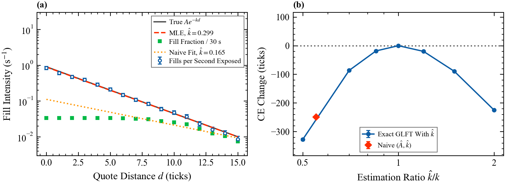

# 7. Optimal market making

Deck: [`slides/decks/07-optimal-market-making.pdf`](../../slides/decks/07-optimal-market-making.pdf) · Code: [`market_making.py`](../../src/stochastic_lob/market_making.py) · Experiments: `e7_market_making.py`, `e11_glft_exact.py`, `e12_signal.py`, `e21_fill_estimation.py`

## The question

Where should a market maker quote, given its inventory, its risk aversion, and how fills respond to price? The control problem has an exact solution; its inputs must be estimated, and errors cost money.

## Model

Mid $\mathrm{d}S_t = m\,\mathrm{d}t + \sigma\,\mathrm{d}W_t$ with drift $m$ (ticks/s) and volatility $\sigma$ (ticks/√s). Quotes at $S - d^b$ and $S + d^a$ (ticks) fill at rate $\Lambda(d) = Ae^{-kd}$, with $A$ (1/s) and $k$ (1/tick). Cash $x$, inventory $y$ ($|y| \le Q$ shares), horizon $T$ (s), risk aversion $\gamma$ (1/tick per share). Maximize $\mathbb{E}[-\exp(-\gamma(x_T + y_TS_T))]$. The HJB equation for the value $u(t,x,y,S)$:

$$0 = \partial_t u + m\,\partial_S u + \tfrac12\sigma^2\partial_{SS}u + \sup_{d^b} Ae^{-kd^b}[u(x - S + d^b, y+1) - u] + \sup_{d^a} Ae^{-kd^a}[u(x + S + d^a, y-1) - u].$$

## Solutions

**Avellaneda and Stoikov (2008)**, first order in inventory: reservation price $r_t = S_t - y\gamma\sigma^2(T-t)$, total spread $\gamma\sigma^2(T-t) + \frac2\gamma\ln(1 + \frac\gamma k)$.

**Guéant, Lehalle and Fernandez-Tapia (2013)**, exact. The ansatz $u = -e^{-\gamma(x+yS)}v_y(t)^{-\gamma/k}$ gives $\dot v = Mv$, $v(T) = \mathbf 1$, with tridiagonal

$$M_{yy} = \tfrac k2\gamma\sigma^2y^2 - kmy, \qquad M_{y,y\pm1} = -A\big(1 + \tfrac\gamma k\big)^{-(1+k/\gamma)},$$

$$v(t) = e^{-M(T-t)}\mathbf 1, \qquad d^b = \frac1k\ln\frac{v_y}{v_{y+1}} + \frac1\gamma\ln\Big(1 + \frac\gamma k\Big), \qquad d^a = \frac1k\ln\frac{v_y}{v_{y-1}} + \frac1\gamma\ln\Big(1 + \frac\gamma k\Big).$$

Every entry of $M$ is a rate (1/s). `glft_exact_quotes` diagonalizes $M$ once.

## Estimating the fill curve

Quote spells $i$ at distance $d_i$ rest for $\tau_i$ seconds and end in a fill ($n_i = 1$) or a cancellation ($n_i = 0$, right-censored). The log-likelihood is

$$\ell(A,k) = \sum_i\big[n_i(\ln A - kd_i) - Ae^{-kd_i}\tau_i\big],$$

a Poisson regression with exposure. `fit_fill_intensity` maximizes it by Newton's method. The naive alternative divides the fill fraction within $t_{\max}$ by $t_{\max}$; but $P(\text{fill}) = 1 - e^{-Ae^{-kd}t_{\max}}$ saturates near the touch, so $k$ is biased down.

## Results in this repository

- AS example (E7): inventory-skewed quotes give mean profit 65.1 with standard deviation 6.5, against 67.4 and 12.7 for the same spread centred on the mid (price units, 1,000 paths).
- Exact against approximate quotes (E11, GLFT example parameters, 2,000 paths): certainty equivalent (CE) 1291.9 ticks for the exact solution, 1277.7 for AS, 1227.7 for symmetric quotes; stationary exact quotes match the closed form within 0.001 ticks near zero inventory.
- Signals (E12): a drift that flips sign with mean life 60 s, fed raw into the permanent-drift solution, loses $54.6 \pm 2.9$ ticks of CE; shrinking it to a quarter gains $10.2 \pm 1.0$. With a 300 s life the best shrinkage is 0.75, gaining $53.7 \pm 5.8$.
- Fill curve (E21): 6,400 spells, at most 30 s each. MLE $\hat A = 0.886 \pm 0.022$ /s, $\hat k = 0.299 \pm 0.003$ /tick (true 0.9 and 0.3); naive $\hat A = 0.111$, $\hat k = 0.165$.
- Model risk (E21): exact quotes computed with a wrong $k$ and run against the true fills. Halving $k$ costs $328.0 \pm 1.9$ ticks of CE out of 1292.5; doubling it costs $225.1 \pm 1.3$; the naive estimate costs $249.5 \pm 1.8$.

## Assumptions

Exponential fill curve; fills independent of the next price move (no adverse selection); constant $\sigma$, $A$, $k$; unit size.

## For a liquidity provider

Use the exact solution; estimate the fill curve by exposure likelihood; shrink signals by their life; remember that fills are not independent of what the price does next (topic 8).

## Further reading

Guéant (2017) for multi-asset quotes; Cartea, Jaimungal and Penalva (2015) for the full control toolbox; Gašperov et al. (2021) for reinforcement learning approaches.
