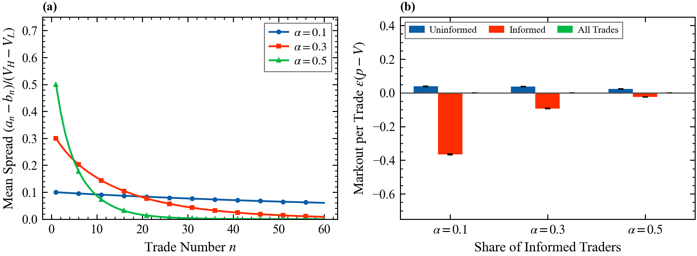
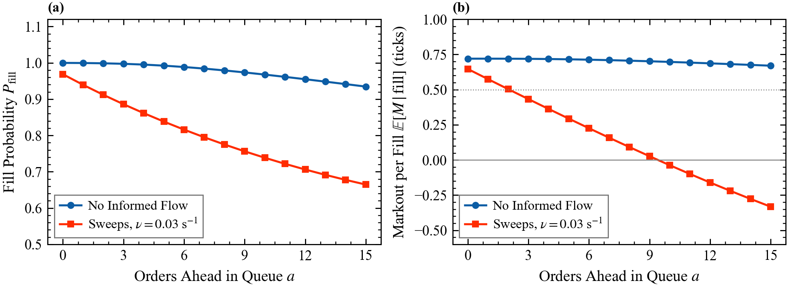

# 8. Adverse selection and queue priority

Deck: [`slides/decks/08-adverse-selection-queue-priority.pdf`](../../slides/decks/08-adverse-selection-queue-priority.pdf) · Code: [`adverse_selection.py`](../../src/stochastic_lob/adverse_selection.py), [`markouts.py`](../../src/stochastic_lob/markouts.py), [`queue_position.py`](../../src/stochastic_lob/queue_position.py) · Experiments: `e9_queue_value.py`, `e10_markouts.py`, `e22_glosten_milgrom.py`

## The question

A passive fill earns half the spread, and it also says that someone wanted to trade with you now. How much of the spread goes back to the price move that follows, and what decides it: information, queue mechanics, or speed?

## The accounting identity

Fill $j$ at time $t_j$ (s) and price $p_j$, with $\varepsilon_j = +1$ if the LP sold and $-1$ if it bought; inventory $y_t = -\sum_{t_j < t}\varepsilon_j$; mid $S_t$. Starting flat, the marked-to-market P&L is exactly

$$\Pi_T = \sum_j \varepsilon_j(p_j - S_{t_j}) + \int_0^T y_{t^-}\,\mathrm{d}S_t .$$

The markout at horizon $h$ (s) splits into half-spread minus adverse selection:

$$M_j(h) = \varepsilon_j(p_j - S_{t_j+h}) = \varepsilon_j(p_j - S_{t_j}) - \varepsilon_j(S_{t_j+h} - S_{t_j}).$$

## Glosten and Milgrom (1985)

Value $V \in \{V_L, V_H\}$, belief $\pi = P(V = V_H)$. Each period a trader is informed with probability $\alpha$; otherwise buys or sells with probability 1/2. A competitive, risk-neutral market maker quotes $a = \mathbb{E}[V \mid \text{buy}]$, $b = \mathbb{E}[V \mid \text{sell}]$. At $\pi = 1/2$, $a - b = \alpha(V_H - V_L)$. Beliefs update by Bayes' rule and the spread closes. In Kyle (1985) the price moves linearly in net order flow with slope $\sigma_v/(2\sigma_u)$, for value standard deviation $\sigma_v$ and noise-trade standard deviation $\sigma_u$. In both, the market maker's expected profit is zero.

## Toxicity without information, and the value of priority

In the zero-intelligence book nobody is informed, yet the fill that takes the last order of a queue is the fill that moves the price. The queue-position model holds one sell order at the best ask with $a$ orders ahead and $b$ behind and a bid queue $c$. Market buys ($\mu$) hit the front, limit sells ($\lambda$) join the back, each other order cancels at $\theta$, and informed sweeps at rate $\nu$ take the whole queue and move fair value $J$ ticks (idea from Moallemi and Yuan). Value per fill against the mid after the next price change is $\tfrac12 - \mathrm{AS}$, with AS $= 1$ if the fill empties the queue, $2P_\uparrow(c,b) - 1$ otherwise, and $J$ after a sweep. It is solved exactly as an absorbing Markov chain.

## Results in this repository

- Glosten-Milgrom (E22), 40,000 paths per $\alpha$, $V_H - V_L = 1$: the first spread equals $\alpha$ (0.300 at $\alpha = 0.3$); the mean spread halves after 5 trades at $\alpha = 0.5$ and 11 at $\alpha = 0.3$, and not within 60 trades at $\alpha = 0.1$. At $\alpha = 0.3$ the markout against the true value is $+0.0369 \pm 0.0003$ per uninformed trade, $-0.0933 \pm 0.0005$ per informed trade, and $0.0001 \pm 0.0001$ overall.
- Markouts in the zero-intelligence book (E10): 16,503 fills; the 28% that empty the queue keep $0.04 \pm 0.01$ ticks against $0.61 \pm 0.00$ for the rest.
- Queue value (E9): in a 16-order queue with sweeps at $\nu = 0.03$/s and $J = 2$, the front fills with probability 0.97 and earns 0.65 ticks per fill; the back fills with probability 0.66 and loses 0.33. Joining behind 10 orders loses money. Without sweeps the curve is flat (0.72 to 0.67).

## What published research reports

- London Stock Exchange message data including failed orders: about one latency race per minute per FTSE 100 symbol; races are about 20% of volume and about a third of price impact and effective spread; eliminating them would cut the cost of liquidity by about 17% (Aquilina, Budish and O'Neill 2022).
- Frequent batch auctions replace competition on speed with competition on price (Budish, Cramton and Shim 2015).
- A broker can learn a trend signal from informed clients' flow and decide what to internalize (Cartea and Sánchez-Betancourt 2025); online Bayesian neural networks predict toxic client trades (Cartea, Duran-Martin and Sánchez-Betancourt 2023).

## For a liquidity provider

Measure markouts, not fill rates; condition on queue state, imbalance and counterparty. Priority is an asset whose value grows with informed sweeps. Some adverse selection is mechanical and predictable from the book alone.
