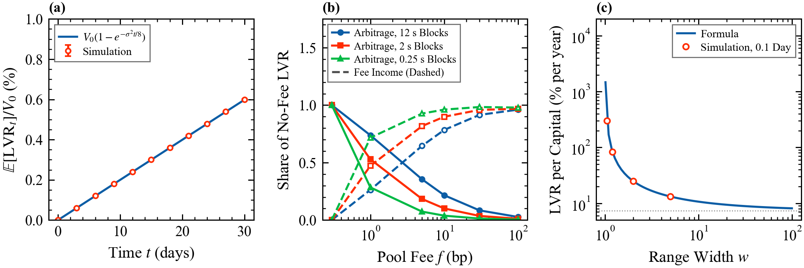

# 9. Liquidity in automated market makers

Deck: [`slides/decks/09-amm-liquidity.pdf`](../../slides/decks/09-amm-liquidity.pdf) · Code: [`amm.py`](../../src/stochastic_lob/amm.py) · Experiment: `e13_lvr.py`

## The question

An automated market maker (AMM) has no queue and no quotes. What does it cost to provide liquidity on a curve, and how do fees, block time and concentration change the bill?

## Constant-product pools

A pool holds $x$ units of a risky asset and $y$ of the numeraire with $xy = L^2$ ($L$: liquidity). Its price is $P = y/x$, so $x(P) = L/\sqrt P$, $y(P) = L\sqrt P$, and value $V = 2L\sqrt P$. The exchange price follows $\mathrm{d}P = \sigma P\,\mathrm{d}W$, with volatility $\sigma$ (time$^{-1/2}$).

## Loss-versus-rebalancing (LVR)

Compare the pool with a portfolio that holds the same $x(P_t)$ but trades at $P_t$: $\mathrm{d}R = x(P)\,\mathrm{d}P$ (Milionis et al. 2022). For any constant-function pool $V'(P) = x(P)$, since $y'(P) = -Px'(P)$. Itô's formula gives

$$\mathrm{d}V - \mathrm{d}R = \tfrac12x'(P)\sigma^2P^2\,\mathrm{d}t \le 0, \qquad \frac{\mathrm{d}\,\mathrm{LVR}}{\mathrm{d}t} = \frac{\sigma^2P^2}{2}|x'(P)| = \frac{\sigma^2}{8}V \text{ (constant product)}.$$

Because $\mathbb{E}\sqrt{P_T} = \sqrt{P_0}e^{-\sigma^2T/8}$, $\mathbb{E}[\mathrm{LVR}_T] = V_0(1 - e^{-\sigma^2T/8})$ exactly.

## Concentrated liquidity (derived here)

On $[P_a, P_b]$, $x(P) = L(P^{-1/2} - P_b^{-1/2})$ inside the range, so $x'(P)$ and the LVR rate $\frac{\sigma^2}{4}L\sqrt P$ are the same as for the full curve, while the capital is smaller. For $[P/w, Pw]$, $w > 1$, centred in log price: $V = 2L\sqrt P(1 - w^{-1/2})$ and

$$\frac{\mathrm{LVR}}{V} = \frac{\sigma^2}{8(1 - w^{-1/2})} \quad \text{per unit time, while } P \text{ is in range.}$$

$w \to \infty$ recovers $\sigma^2/8$. Checked by simulation to 2% (`test_liquidity.py`).

## Fees and blocks

With fee $f$, arbitrage pays only outside a no-trade band around the pool price; with blocks $\Delta t$ apart, the price can jump through the band. Arbitrage profit falls below LVR and part of LVR returns to the LP as fees (Milionis, Moallemi and Roughgarden 2023). `simulate_cpmm_arbitrage` trades the pool to the edge of the band at each block, with the fee on the input.

## Results in this repository (E13)

- $\sigma = 0.04$ per √day (about 76% a year): LVR costs 7.3% of capital per year; the 30-day simulation gives $0.598 \pm 0.001\%$ against the exact 0.598%.
- At 5 bp fees and 12 s blocks, arbitrage keeps 0.35 and fees return 0.65 of the no-fee LVR; at 30 bp, 0.08 and 0.92.
- A $w = 1.1$ range pays 21.5 times the full-range LVR per unit of capital.

## For a liquidity provider

Price the position by LVR, not impermanent loss. Fees must exceed the arbitrage share of LVR; faster blocks help the LP. Concentration scales cost and fee income together. The economics match stale quotes in a book (topic 8): adverse selection from public information.

## Open question

Which design, book or AMM, with which fee and block time, minimizes the total cost of liquidity for a given asset?
